# Enterprise Multi-Tenant RAG with Role-Based Access Control (RBAC)

**Datheon Forward Deployed Engineering (FDE) Internship — Task 2 (Advanced)**

An enterprise-grade, multi-tenant Retrieval-Augmented Generation (RAG) engine and authenticated FastAPI service built on ChromaDB (cosine distance), ONNX Cross-Encoder reranking, defense-in-depth RBAC pre/post-retrieval enforcement, canonical citation locators, and numeric/entity hallucination guardrails.

---

## Architecture & Security Design

```mermaid
flowchart LR
    A["HTTP Request + X-API-Key"] --> B["Auth Layer (401 / 403 / 422)"]
    B --> C["Server-Side UserPrincipal (tenant_id, tier, depts)"]
    C --> D["Query Rewriter (Acronyms + Advisory Injection Check)"]
    D --> E["ChromaDB Cosine Pre-Filter (Tenant + Tier-1 Public + Tier/Dept)"]
    E --> F["Post-Retrieval RBAC Assertion (assert_hits_authorized)"]
    F --> G["Candidate-Scoped Reranker (OnnxCrossEncoder / LexicalReranker)"]
    G --> H["Marker-Based Synthesizer ([1], [2])"]
    H --> I["Numeric & Entity Guardrails (Canonical Float Match)"]
    I --> J["Citation Renderer + AuditLogger"]
```



### Key Architectural Guarantees
1. **Server-Side Authentication (`401` / `403` / `422`):**
   - `POST /api/v1/rag/query` resolves caller identity exclusively from the `X-API-Key` (or `Authorization: Bearer`) header via `API_KEY_REGISTRY` (`401 Unauthorized` when missing or invalid).
   - Authenticated principals with empty department scope are rejected with `403 Forbidden`.
   - The request body (`RAGQueryRequest`) enforces `ConfigDict(extra="forbid")`, rejecting any client attempt to inject `clearance_tier`, `departments`, or `tenant_id` in JSON (`422 Unprocessable Entity`).
2. **Multi-Tenant Isolation + Tier-1 Public Rule:**
   - Every chunk and `UserPrincipal` carries `tenant_id` (`acme_corp` vs. `globex_inc`). Cross-tenant reads are blocked at both the ChromaDB `where` filter and post-retrieval assertion.
   - Within the same `tenant_id`, **Tier 1 (`Public Internal`)** documents are readable across all departments, while **Tiers 2–4** require both `clearance_tier <= principal.clearance_tier` and `department in principal.departments`.
3. **Double RBAC Barrier & Uniform Abstention:**
   - Pre-filtering occurs inside ChromaDB (`query_by_tier_and_department`), followed immediately by `assert_hits_authorized` before reranking.
   - Any post-retrieval `RBACViolationError` is caught, logged to `AuditLogger` (`rbac_violation_blocked=True`), and converted into `UNIFORM_ABSTENTION_MESSAGE` (`abstention_reason="no_authorized_results"`), preventing existence leaks.
4. **Candidate-Scoped Cross-Encoder Reranking:**
   - Over-fetches up to `overfetch_k=24` authorized chunks and reranks down to `top_k=5`.
   - Supports `OnnxCrossEncoder` (`Xenova/ms-marco-MiniLM-L-6-v2` via `onnxruntime` + `tokenizers`) and deterministic `LexicalReranker` (computing BM25 IDF strictly over authorized candidates so restricted corpus statistics never leak).
5. **Marker-Based Hallucination Guardrails & Canonical Citation Locators:**
   - Generators emit `DraftStatement(text, cited_indices=(1,))` prior to citation tag rendering so digits inside filenames or page numbers never cause false numeric mismatches.
   - `extract_canonical_numbers` normalizes currency, commas, and suffixes (`$450,000` == `450000` == `450000.0`; `$14.5M` == `$14,500,000` == `14500000.0`), and `extract_key_entities` verifies structured identifiers (`FIN-Q3-002`, `SUP-101`, `10.42.0.0/16`, `FIDO2`, `Aegis-X`).
   - Verified statements render into a 4-level canonical locator hierarchy:
     1. **PDF Page:** `[security_compliance_tier1.pdf, p. 2]`
     2. **CSV / JSON Row:** `[hr_compensation_bands_tier2.csv, row 3]`
     3. **Markdown Section:** `[engineering_cloud_vpc_runbook_tier2.md, §Cloud Infrastructure & VPC Peering Runbook > 1. Network Topology & Peering]`
     4. **Chunk Fallback (TXT):** `[legal_ip_license_agreement_tier4.txt, chunk 1]`

---

## 6-Persona RBAC Matrix

| Persona ID | API Key | Tenant | Clearance Tier | Authorized Departments | Accessible `acme_corp` Files |
| :--- | :--- | :--- | :---: | :--- | :--- |
| `ops_associate` | `key-ops-tier1` | `acme_corp` | Tier 1 | `operations` | `security_compliance_tier1.pdf`, `operations_supplier_catalog_tier1.json` |
| `cloud_engineer` | `key-eng-tier2` | `acme_corp` | Tier 2 | `engineering` | Tier 1 files + `engineering_cloud_vpc_runbook_tier2.md` |
| `hr_specialist` | `key-hr-tier2` | `acme_corp` | Tier 2 | `hr` | Tier 1 files + `hr_compensation_bands_tier2.csv` |
| `finance_director` | `key-fin-tier3` | `acme_corp` | Tier 3 | `finance`, `executive` | Tier 1 files + `finance_q3_budget_audit_tier3.csv`, `executive_ai_roadmap_tier3.md` |
| `general_counsel` | `key-leg-tier4` | `acme_corp` | Tier 4 | All 6 departments | All 8 `acme_corp` files (including `merger_acquisition_audit_tier4.pdf`, `legal_ip_license_agreement_tier4.txt`) |
| `external_tenant` | `key-globex-tier4` | `globex_inc` | Tier 4 | All 6 departments | **0 files** in `acme_corp` (strict tenant isolation) |

---

## Quickstart & CLI Usage

### 1. Install Dependencies
```bash
pip install -r requirements.txt
```

### 2. Generate Sample Corpus & Ingest
```bash
python -m scripts.make_sample_data
python -m src.rag.cli ingest
```

### 3. Inspect RBAC Personas
```bash
python -m src.rag.cli personas
```

### 4. Ask Questions as Different Personas
```bash
# Allowed Tier-2 Engineering query
python -m src.rag.cli ask --persona cloud_engineer --query "What is the CIDR block of vpc-prod-compute?"

# Denied Tier-4 M&A query by Tier-2 Engineer (uniform abstention)
python -m src.rag.cli ask --persona cloud_engineer --query "What is the Project Titan purchase price?"

# Allowed Tier-4 M&A query by General Counsel
python -m src.rag.cli ask --persona general_counsel --query "What is the Project Titan aggregate purchase price and founder buyout?"
```

### 5. Run Ground-Truth RBAC & Accuracy Evaluation
```bash
python -m src.rag.cli eval --out reports/rag_eval.json
```

### 6. Start the Authenticated FastAPI Service
```bash
python -m src.rag.cli serve --host 127.0.0.1 --port 8000
```

Example `curl` request:
```bash
curl -X POST http://127.0.0.1:8000/api/v1/rag/query \
  -H "Content-Type: application/json" \
  -H "X-API-Key: key-leg-tier4" \
  -d '{"query": "What is the Project Titan aggregate purchase price and founder buyout?", "top_k": 5}'
```

---

## Running Tests

```bash
# Fast unit & integration suite (FakeEmbedding + LexicalReranker)
python -m pytest -q

# Real neural embedding & ONNX cross-encoder suite
python -m pytest -m real_models -v
```

