# Enterprise Multi-Tenant RAG with Role-Based Access Control (RBAC)

**Datheon Forward Deployed Engineering (FDE) Internship — Task 2 (Advanced)**

An enterprise-grade, multi-tenant Retrieval-Augmented Generation (RAG) engine and authenticated FastAPI service built on ChromaDB (cosine distance), ONNX Cross-Encoder reranking, defense-in-depth RBAC pre/post-retrieval enforcement, canonical citation locators, and numeric/entity hallucination guardrails.

---

## Folder Structure

```text
Task_2_Enterprise_Multi_Tenant_RAG_with_RBAC/
├── README.md                         # Architecture, RBAC matrix, evaluation metrics & quickstart
├── requirements.txt                  # Pinned Python dependencies
├── pytest.ini                        # Pytest configuration & real_models marker
├── data/
│   └── sample_documents/             # Multi-format enterprise corpus + manifest.yaml
├── reports/
│   └── rag_eval.json                 # 19-case multi-persona RBAC & ground-truth evaluation report
├── scripts/
│   └── make_sample_data.py           # Deterministic sample corpus generator
├── src/
│   ├── config.py                     # RAG, ETL & ChromaDB configuration
│   ├── api/
│   │   └── app.py                    # Authenticated FastAPI service (/api/v1/rag/query, /personas)
│   ├── etl/                          # Multi-format extractors, recursive chunker, tenant-aware vector store
│   └── rag/
│       ├── models.py                 # Pydantic schemas for principals, citations, guardrails & responses
│       ├── rbac.py                   # 6-persona registry, API key auth, pre/post-retrieval RBAC barrier
│       ├── query_rewriter.py         # Enterprise acronym expansion & advisory prompt-injection detector
│       ├── reranker.py               # OnnxCrossEncoder & candidate-scoped LexicalReranker (BM25)
│       ├── synthesizer.py            # Marker-based extractive synthesizer & 4-level locator renderer
│       ├── guardrails.py             # Canonical numeric & structured entity hallucination verifier
│       ├── engine.py                 # End-to-end MultiTenantRAGEngine with uniform abstention
│       ├── eval.py                   # 19-case RBAC leak & citation accuracy evaluation harness
│       └── cli.py                    # Typer + Rich CLI (ingest, personas, ask, eval, serve)
└── tests/                            # Unit, integration, API, CLI & real neural model test suite
```

---

## Architecture & Security Design

```mermaid
flowchart LR
    A["HTTP Request + X-API-Key"] --> B["Auth Layer (401 / 403 / 422)"]
    B --> C["Server-Side UserPrincipal (tenant_id, tier, depts)"]
    C --> D["Query Rewriter (Acronyms + Advisory Injection Check)"]
    D --> E["ChromaDB Cosine Pre-Filter (Tenant + Tier-1 Public + Tier/Dept)"]
    E --> F["Post-Retrieval RBAC Assertion (assert_hits_authorized)"]
    F --> G["Candidate-Scoped Reranker (OnnxCrossEncoder / LexicalReranker)"]
    G --> H["Marker-Based Synthesizer ([1], [2])"]
    H --> I["Numeric & Entity Guardrails (Canonical Float Match)"]
    I --> J["Citation Renderer + AuditLogger"]
```



### Key Architectural Guarantees
1. **Server-Side Authentication (`401` / `403` / `422`) & Env-Var Credential Loading:**
   - Both `POST /api/v1/rag/query` and `GET /api/v1/rag/personas` require authentication via the `X-API-Key` (or `Authorization: Bearer`) header (`401 Unauthorized` when missing or invalid).
   - API keys are loaded from environment variables (`RAG_API_KEYS_JSON` or `RAG_API_KEY_<PERSONA_ID_UPPER>`) via `load_api_key_registry()`, with local demo keys used only when environment variables are unset.
   - Authenticated principals with empty department scope are rejected with `403 Forbidden`.
   - The request body (`RAGQueryRequest`) enforces `ConfigDict(extra="forbid")`, rejecting any client attempt to inject `clearance_tier`, `departments`, or `tenant_id` in JSON (`422 Unprocessable Entity`).
2. **Fail-Closed Multi-Tenant Isolation + Tier-1 Public Rule:**
   - Every chunk and `UserPrincipal` carries `tenant_id` (`acme_corp` vs. `globex_inc`). Chunks missing `tenant_id` fail closed (`is_chunk_authorized` returns `False`). Cross-tenant reads are blocked at both the ChromaDB `where` filter and post-retrieval assertion.
   - Within the same `tenant_id`, **Tier 1 (`Public Internal`)** documents are readable across all departments, while **Tiers 2–4** require both `clearance_tier <= principal.clearance_tier` and `department in principal.departments`.
3. **Double RBAC Barrier & Strictly Uniform Abstention:**
   - Pre-filtering occurs inside ChromaDB (`query_by_tier_and_department`), followed immediately by `assert_hits_authorized` before reranking.
   - Every abstention (whether triggered by zero authorized hits, post-retrieval RBAC violation, low rerank relevance, or guardrail rejection) returns the exact same `UNIFORM_ABSTENTION_MESSAGE`, `abstention_reason="no_authorized_results"`, and an empty `GuardrailReport`, preventing existence or stage-progression side-channel leaks while logging `authorized_candidates` in `AuditLogger`.
4. **Candidate-Scoped Cross-Encoder Reranking:**
   - Over-fetches up to `overfetch_k=24` authorized chunks and reranks down to `top_k=5`.
   - Supports `OnnxCrossEncoder` (`Xenova/ms-marco-MiniLM-L-6-v2` via `onnxruntime` + `tokenizers`) and deterministic `LexicalReranker` (computing BM25 IDF strictly over authorized candidates so restricted corpus statistics never leak).
5. **Marker-Based Hallucination Guardrails & Canonical Citation Locators:**
   - Generators emit `DraftStatement(text, cited_indices=(1,))` prior to citation tag rendering so digits inside filenames or page numbers never cause false numeric mismatches.
   - `extract_canonical_numbers` normalizes currency, commas, and suffixes (`$450,000` == `450000` == `450000.0`; `$14.5M` == `$14,500,000` == `14500000.0`), and `extract_key_entities` verifies structured identifiers (`FIN-Q3-002`, `SUP-101`, `10.42.0.0/16`, `FIDO2`, `Aegis-X`).
   - Verified statements render into a 4-level canonical locator hierarchy:
     1. **PDF Page:** `[security_compliance_tier1.pdf, p. 2]`
     2. **CSV / JSON Row:** `[hr_compensation_bands_tier2.csv, row 4]`
     3. **Markdown Section:** `[engineering_cloud_vpc_runbook_tier2.md, §Cloud Infrastructure & VPC Peering Runbook > 1. Network Topology & Peering]`
     4. **Chunk Fallback (TXT):** `[legal_ip_license_agreement_tier4.txt, chunk 1]`

---

## 6-Persona RBAC Matrix

| Persona ID | Env Var Override | Tenant | Clearance Tier | Authorized Departments | Accessible `acme_corp` Files |
| :--- | :--- | :--- | :---: | :--- | :--- |
| `ops_associate` | `RAG_API_KEY_OPS_ASSOCIATE` | `acme_corp` | Tier 1 | `operations` | `security_compliance_tier1.pdf`, `operations_supplier_catalog_tier1.json` |
| `cloud_engineer` | `RAG_API_KEY_CLOUD_ENGINEER` | `acme_corp` | Tier 2 | `engineering` | Tier 1 files + `engineering_cloud_vpc_runbook_tier2.md` |
| `hr_specialist` | `RAG_API_KEY_HR_SPECIALIST` | `acme_corp` | Tier 2 | `hr` | Tier 1 files + `hr_compensation_bands_tier2.csv` |
| `finance_director` | `RAG_API_KEY_FINANCE_DIRECTOR` | `acme_corp` | Tier 3 | `finance`, `executive` | Tier 1 files + `finance_q3_budget_audit_tier3.csv`, `executive_ai_roadmap_tier3.md` |
| `general_counsel` | `RAG_API_KEY_GENERAL_COUNSEL` | `acme_corp` | Tier 4 | All 6 departments | All 8 `acme_corp` files (including `merger_acquisition_audit_tier4.pdf`, `legal_ip_license_agreement_tier4.txt`) |
| `external_tenant` | `RAG_API_KEY_EXTERNAL_TENANT` | `globex_inc` | Tier 4 | All 6 departments | **0 files** in `acme_corp` (strict tenant isolation) |

---

## Real-Model Ground-Truth Evaluation (`reports/rag_eval.json`)

Executed with real ChromaDB ONNX embeddings (`all-MiniLM-L6-v2`) and `OnnxCrossEncoder` (`Xenova/ms-marco-MiniLM-L-6-v2`) across all 19 multi-persona evaluation cases against `manifest.yaml` ground truth:

| Metric | Result |
| :--- | :---: |
| **Total Evaluation Cases** | `19` (12 positive + 7 unauthorized/injection/cross-tenant) |
| **RBAC Leaks (vs. `manifest.yaml` Ground Truth)** | `0` |
| **Abstention Accuracy** | `100.0%` |
| **Gold Answer Accuracy** | `100.0%` |
| **Gold Citation Locator Accuracy** | `100.0%` |
| **Guardrail Pass Rate** | `100.0%` |
| **End-to-End Query Latency (P50 / P95)** | `370.4 ms` / `915.7 ms` |

---

## Quickstart & CLI Usage

### 1. Install Dependencies
```bash
pip install -r requirements.txt
```

### 2. Generate Sample Corpus & Ingest
```bash
python -m scripts.make_sample_data
python -m src.rag.cli ingest
```

### 3. Inspect RBAC Personas
```bash
python -m src.rag.cli personas
```

### 4. Ask Questions as Different Personas
```bash
# Allowed Tier-2 Engineering query
python -m src.rag.cli ask --persona cloud_engineer --query "What is the CIDR block of vpc-prod-compute?"

# Denied Tier-4 M&A query by Tier-2 Engineer (uniform abstention)
python -m src.rag.cli ask --persona cloud_engineer --query "What is the Project Titan purchase price?"

# Allowed Tier-4 M&A query by General Counsel
python -m src.rag.cli ask --persona general_counsel --query "What is the Project Titan aggregate purchase price and founder buyout?"
```

### 5. Run Ground-Truth RBAC & Accuracy Evaluation
```bash
# Default: real Chroma embeddings + OnnxCrossEncoder
python -m src.rag.cli eval --out reports/rag_eval.json
```

### 6. Start the Authenticated FastAPI Service
```bash
python -m src.rag.cli serve --host 127.0.0.1 --port 8000
```

---

## Running Tests

```bash
# Fast unit & integration suite (domain-agnostic 256-dim feature hashing + LexicalReranker)
python -m pytest -q

# Real neural embedding & ONNX cross-encoder suite
python -m pytest -m real_models -v
```
