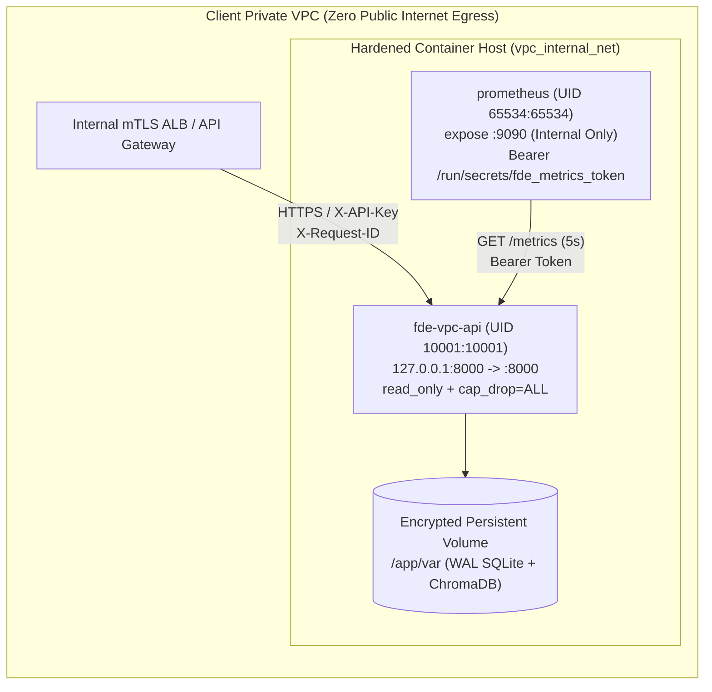

# Datheon Client VPC Integration & Operations Guide

This guide provides Forward Deployed Engineers (FDEs) and client infrastructure teams with the production runbook for deploying, hardening, monitoring, and operating the **Datheon Client VPC AI Microservice Gateway** inside an isolated or air-gapped enterprise Virtual Private Cloud (VPC).

---

## 1. Reference VPC Network Topology



### Network & Container Security Controls
- **Loopback Host Binding:** `docker-compose.yml` binds the gateway strictly to `127.0.0.1:8000:8000` so the container port is never exposed directly on `0.0.0.0` to untrusted LAN segments; external traffic enters through the client's internal mTLS reverse proxy / ALB.
- **Internal-Only Telemetry Scraping:** The `prometheus` container uses `expose: ["9090"]` on `vpc_internal_net` with **no** host `ports:` published, preventing unauthenticated external access to the Prometheus UI or TSDB.
- **Least-Privilege Runtime:** Both `fde-vpc-api` (`UID 10001:10001`) and `prometheus` (`UID 65534:65534`) run with `read_only: true`, `tmpfs: ["/tmp"]`, `cap_drop: ["ALL"]`, and `security_opt: ["no-new-privileges:true"]`.

---

## 2. Secret Provisioning & Rotation Runbook

### Fail-Closed Production Enforcement
When `FDE_ENV=production` (the default in `Dockerfile` and `docker-compose.yml`), `load_secret_bundle()` in `src/vpc_service/secrets.py` **fails closed** on startup:
1. It refuses to fall back to development API keys if `FDE_API_KEYS_JSON_FILE` / `FDE_API_KEYS_FILE` and `FDE_API_KEYS_JSON` are unset.
2. It rejects any API key or metrics bearer token shorter than 20 characters or starting with placeholder prefixes (`dev-key-`, `key-`, `REPLACE_WITH_`, `test-`, `changeme`).
3. `SecretBundle.__repr__`, `__str__`, and `to_redacted_dict()` mask all secret tokens as `***REDACTED***` so credentials never leak into stack traces or JSON access logs.

### Initializing Secrets for Local Compose / Smoke Testing
Never commit `deploy/secrets/fde_api_keys.json` or `deploy/secrets/fde_metrics_token.txt` to version control (both are excluded in `.gitignore` and `.dockerignore`). Generate cryptographically random local secret files (`chmod 0644` so non-root UIDs `10001` and `65534` can read mounted `/run/secrets/*` files) via:

```bash
python -m src.vpc_service.cli init-dev-secrets --out-dir deploy/secrets
python -m src.vpc_service.cli check-secrets --env production \
  --api-keys-file deploy/secrets/fde_api_keys.json \
  --metrics-token-file deploy/secrets/fde_metrics_token.txt
```

---

## 3. Air-Gapped Registry & Offline Model Baking

1. **Base Image Digest Pinning:** Before building for an air-gapped client VPC, mirror `python:3.12-slim` and `prom/prometheus:v2.54.1` into the client's private registry (Harbor / AWS ECR Private) and pin both `FROM` stages in `Dockerfile` by immutable SHA-256 digest:
   ```dockerfile
   FROM <client-registry.internal>/python:3.12-slim@sha256:<immutable-digest> AS builder
   ```
2. **Offline Model Pre-Warming (`PRELOAD_HF_MODELS`):**
   - By default (`PRELOAD_HF_MODELS=false`), the image installs `requirements-docker.txt` and uses deterministic offline embeddings (`DeterministicHashEmbedding`) and lexical cross-encoder reranking (`LexicalReranker`) for fast, zero-egress builds.
   - To bake HuggingFace `SentenceTransformer` (`BAAI/bge-small-en-v1.5`) and `CrossEncoder` (`cross-encoder/ms-marco-MiniLM-L-6-v2`) weights into `/opt/models` during image build:
     ```bash
     docker build --build-arg PRELOAD_HF_MODELS=true -t datheon/fde-vpc-gateway:1.0.0 .
     ```
   - At runtime, `FDE_AIRGAPPED_MODE=true`, `HF_HUB_OFFLINE=1`, and `TRANSFORMERS_OFFLINE=1` guarantee zero outbound network calls.

---

## 4. Multi-Tenant RBAC & Per-Tenant Data Isolation

Every authenticated API key resolves to an immutable `VPCPrincipal`:
- **Knowledge Base Isolation (`/api/v1/rag/query`):** `MultiTenantRAGEngine` enforces defense-in-depth ChromaDB metadata filtering AND post-retrieval RBAC verification across `tenant_id`, `clearance_tier`, and `departments`. Unauthorized queries return `abstained: true` with `abstention_reason: "no_authorized_results"`.
- **ERP/CRM & Session Isolation (`/api/v1/agent/*`):**
  - Each tenant (`acme_corp`, `globex_inc`) has an isolated SQLite ERP database (`var/acme_corp_erp.db`, `var/globex_inc_erp.db`).
  - Every `AgentRunResult` and `PendingApproval` in `var/agent_sessions.db` stores `tenant_id` and `operator_id`. Cross-tenant session reads, approval listings, or supervisor decisions are rejected with `403 Forbidden`.

---

## 5. Human-in-the-Loop (HITL) Supervisor Approval Operations

1. **Trigger:** When an operator requests a `SENSITIVE_WRITE` tool (`adjust_inventory` or `issue_credit_note`), `AgentOrchestrator` halts execution before mutating the tenant's ERP database, persists a `PendingApproval` containing a canonical SHA-256 `payload_hash`, and returns `status: "AWAITING_APPROVAL"`.
2. **Queue Inspection:** Supervisors query `GET /api/v1/agent/approvals?status=PENDING` (scoped to their `tenant_id`) and monitor the Prometheus gauge `fde_hitl_pending_approvals`.
3. **Decision & Resume:** A supervisor with `agent_role="supervisor"` submits `POST /api/v1/agent/approvals/{approval_id}/decide` with `{"decision": "APPROVE", "reason": "..."}`. Replaying an already-decided approval or deciding an expired approval returns `409 Conflict`.

---

## 6. Prometheus Telemetry Catalog & Alerting Runbook

### Complete 8-Metric Catalog (`/metrics`)

| Metric Name | Type | Labels | Description |
| :--- | :--- | :--- | :--- |
| `fde_http_requests_total` | `Counter` | `method`, `route`, `status_code` | Total HTTP requests normalized by route template (`/api/v1/agent/sessions/{session_id}`, etc.). |
| `fde_http_errors_total` | `Counter` | `method`, `route`, `status_code`, `error_class` | Total HTTP 4xx/5xx responses classified by `auth`, `forbidden`, `validation`, `conflict`, `payload_too_large`, `rate_limited`, `not_found`, `server_error`. |
| `fde_http_request_duration_seconds` | `Histogram` | `method`, `route` | End-to-end HTTP request latency distribution. |
| `fde_llm_tokens_total` | `Counter` | `operation`, `token_type`, `accounting_mode` | Cumulative prompt/completion/total tokens (`accounting_mode="estimated"` offline vs `"provider_reported"` with OpenAI-compatible vLLM/TGI). |
| `fde_rag_queries_total` | `Counter` | `outcome`, `reranker` | RAG queries by outcome (`answered` vs `abstained`). |
| `fde_agent_tool_calls_total` | `Counter` | `tool_name`, `sensitivity`, `status` | Agent tool executions by sensitivity tier and status. |
| `fde_hitl_pending_approvals` | `Gauge` | *(none)* | Current count of `PENDING` supervisor approvals, refreshed on every `/metrics` scrape. |
| `fde_dependency_up` | `Gauge` | `component` | Live health (`1` = healthy, `0` = unhealthy) for `sqlite_db`, `chroma_vector_store`, and `secrets_manager`, refreshed on every `/metrics` scrape and `/readyz` probe. |

### Alert Rules (`deploy/prometheus_rules.yml`)
- `FDEHighErrorRate`: 5xx error ratio `> 2%` over 5 minutes (`for: 2m`).
- `FDEHighP95Latency`: Route p95 latency `> 0.75s` over 5 minutes (`for: 3m`).
- `FDEDependencyDown`: `fde_dependency_up < 1` for any component (`for: 1m`).
- `FDEHitlBacklog`: `fde_hitl_pending_approvals > 20` (`for: 5m`).

---

## 7. Single-Writer SQLite Persistence & Horizontal Scaling Path

- **Why `--workers 1` in Embedded Mode:** Embedded SQLite (`agent_sessions.db`, `<tenant>_erp.db`) and local ChromaDB (`var/chroma_db`) are single-node embedded stores. The gateway configures `PRAGMA journal_mode=WAL; PRAGMA busy_timeout=5000;` on every SQLite connection to handle concurrent async/threadpool requests cleanly within a single Uvicorn worker (`--workers 1`).
- **Multi-Replica Horizontal Scaling:** When scaling beyond a single container replica in Kubernetes, replace the embedded stores with:
  1. Client-managed **PostgreSQL RDS / CloudSQL** for `SessionStore` and ERP tables.
  2. Client-managed **Chroma Server / Qdrant / pgvector** for the vector store.

---

## 8. Graceful Shutdown, Backup/Restore & Incident Triage

- **Graceful Drain:** Uvicorn runs with `--timeout-graceful-shutdown 15`, allowing in-flight RAG queries and SQLite WAL commits to finish cleanly on `SIGTERM` before container exit.
- **Correlation ID Triage:** Every request accepts or generates an `X-Request-ID` header, echoes it on the response, and emits a single-line JSON log record to `stdout` containing `request_id`, `method`, `route`, `status_code`, `latency_ms`, `error_class`, `principal_id`, and `tenant_id`.
- **Volume Backup:** Back up `/app/var` using online SQLite `.backup` or snapshot `fde_vpc_var` during maintenance windows.

